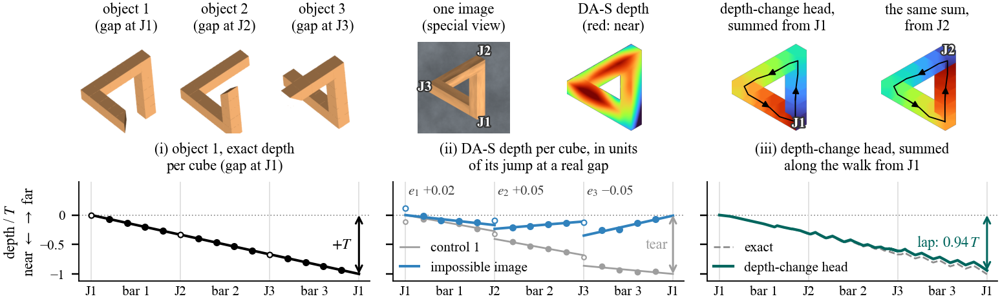
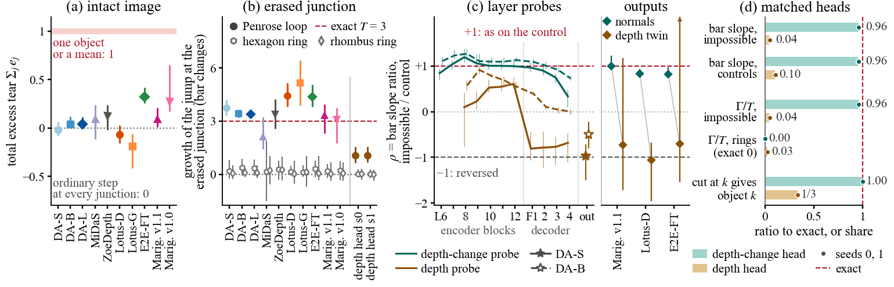

# Three Objects, One Image

**Why Depth Networks Distort the Impossible Triangle**

Itamar Shalom, Yalli Lavi, Dotan Greenspan, Shalom Biton. Final project, Modern Computer Vision (00970202),
Technion, 2026.

Report: [paper/main.pdf](paper/main.pdf)



*Figure 1. Top: three valid objects give one image. Bottom: depth around the loop for object 1 (i), Depth Anything
V2-S (ii) and our depth-change head (iii).*

Depth networks distort the Penrose triangle. We show that they do so because they must output a
depth map. We also show that a linear read-out of Depth Anything V2 gets the corners and bars of the figure right.

We build the triangle from cubes, so its image is pixel for pixel the image of three valid objects (Fig. 1). Each
object is an open chain of three bars with its gap hidden at a different corner (junction). Ten frozen depth networks
output none of the three objects (Fig. 2a). They bend the bars to flat or reversed slopes. The read-out, fitted only on
possible scenes, keeps each bar's slope until the last decoder stages (Fig. 2c). In this read-out every bar comes
nearer, by a total T over one lap (T is the depth jump at a valid object's gap). A depth map cannot represent this,
since depth must return to its start after a lap.

Erasing one corner removes most of the bend (Fig. 2b). In Depth Anything V2, blocking attention to that corner, with the
image left intact, also removes most of it. For this test we measure only the cubes that erasure leaves visible.
Buildable closed rings of the same bars are mostly read correctly. We also train two heads on the same frozen features
and scenes. One outputs depth and one outputs local depth changes. The depth head flattens the bars (they keep 0.39-0.47 of
their slope on its own controls), and Depth Anything V2-S's own decoder on the same encoder reverses them.
The depth-change head keeps them (Fig. 2d). Its bars come 0.96 T nearer per lap (0.00 on the rings), and a cut at any
corner gives the object with its gap there. The head does not show which corners are joined.



## What is where

| path | what |
|---|---|
| `paper/main.tex`, `paper/refs.bib`, `paper/main.pdf` | The report. |
| `figures/fig_hero.py`, `figures/fig_main.py`, `figures/style.py` | Figure 1, Figure 2 and their shared style. `fig_main.py` prints every value it plots. The outputs are in `figures/out/`, together with the cached side views of Figure 1 (`side_trimmed_*.png`). |
| `pdepth/render.py` | Orthographic renderer of cube chains. It makes the shared impossible image, each object's exact depth, the possible controls and the side views. |
| `pdepth/readout.py`, `pdepth/loop.py` | `readout.py` measures the depth of each cube around the loop. `loop.py` computes the bar slopes, the jump at each junction and the excess tear. |
| `pdepth/analysis.py` | Loads the read-out tables and computes bootstrap intervals. |
| `pdepth/models.py` | Runs the ten depth networks (Depth Anything V2 S/B/L, MiDaS DPT-L, ZoeDepth, Lotus-D/G, Marigold E2E-FT, Marigold v1.0/v1.1) and our depth heads (key `head-<name>`). |
| `pdepth/normals.py` | Runs the three surface-normal networks (Marigold v1.1, E2E-FT, Lotus-D) and computes the stimuli's exact normals. |
| `pdepth/probe.py` | Erasure, which replaces a junction by the exact background. |
| `pdepth/scenes.py` | Random possible cube scenes. They are the only training data of the probes and heads. |
| `pdepth/oneform.py` | Depth from local depth changes. It checks whether the loop is closed, computes the loop integral Γ and cuts the loop at a junction. |
| `pdepth/heads.py` | The two matched heads on frozen DA-S, for depth (`0form`) and for depth changes (`1form`). |
| `scripts/make_stimuli.py`, `make_loops.py`, `make_scenes.py` | `make_stimuli.py` renders the 460 stimuli (sets A-E, see its docstring). The report uses the 288 impossible images and the 48 controls, and the gap morph's last step only for the ~3,500-pixel count. `make_loops.py` renders the 64 closed rings and `make_scenes.py` the 1500 training scenes. |
| `scripts/gt_profiles.py`, `scripts/morph_pixels.py` | `gt_profiles.py` computes the objects' exact loop profiles. `morph_pixels.py` counts the pixels that differ between a control and the impossible image. |
| `scripts/run_models.py`, `run_marigold.py` | Run a depth network on the stimuli -> `results/readout_<net>.csv`, `results/mg10_1step.csv`, `mg11_1step.csv`. |
| `scripts/run_probe.py` | Erases each junction in turn, on the stimuli or the rings -> `results/probe_<net>.csv`, `results/probe_loops_<net>.csv`. |
| `scripts/run_normals.py` | Runs a surface-normal network on the stimuli -> `results/normals_<net>-n.csv`. |
| `scripts/run_features.py` | Saves the hidden states of DA-S and DA-B on the stimuli, rings and scenes (`outputs/feats/`, about 21 GB). |
| `scripts/run_attention_cut.py` | Runs the attention cut inside Depth Anything V2 -> `results/attn_<net>.csv`. |
| `scripts/train_heads.py`, `run_heads.py` | `train_heads.py` trains a head, and `run_heads.py` runs it on the stimuli and rings (`outputs/heads_out/`). A depth head also goes through `run_probe.py` and `run_models.py` -> `results/*_head-*.csv`. |
| `scripts/analyze_excess.py` | Total excess tear of each network (Fig. 2a). |
| `scripts/analyze_probe.py`, `analyze_loops.py` | `analyze_probe.py` summarises erasure. `analyze_loops.py` compares the Penrose loop with the closed rings (Fig. 2b). |
| `scripts/analyze_layers.py`, `analyze_normals.py` | `analyze_layers.py` fits the layer probes of DA-S and DA-B. `analyze_normals.py` compares the surface-normal networks with their depth twins (Fig. 2c). |
| `scripts/analyze_glue.py` | Least-squares gluing of a network's own readings. |
| `scripts/analyze_attention.py` | Summarises the attention cut. |
| `scripts/analyze_heads.py` | Summarises the matched heads (Fig. 2d). |
| `scripts/paper_numbers.py` | Prints every number in the report that no other script prints. |
| `scripts/queue_vm.sh`, `queue_vm_probe.sh`, `queue_vm_heads.sh` | The GPU runs, in the order we used on the course's A10 VM. |
| `results/` | The read-out tables (small CSVs), the summaries the analyses write (`summary_*.json`) and the depth-change head's output on Figure 1's image (`fig1_head-1form-s-seed0_A_a060_p0_t0.npz`). |

## Reproduce

Run every command from the repository root. The code needs Python 3.10+. Install PyTorch and torchvision for your
platform first, then run `pip install -r requirements.txt`. `data/` and `outputs/` are not in the repository. The
commands below make them.

### The report from `results/` (CPU, minutes, or ~1 h with Figure 1's images)

```bash
python scripts/make_loops.py data/loops      # the 64 closed rings (~3 min), whose exact slopes analyze_loops.py reads
python scripts/analyze_excess.py             # -> results/summary_excess.json
python scripts/analyze_probe.py              # -> results/summary_probe.json
python scripts/analyze_loops.py dav2-s dav2-b dav2-l dpt-l zoe lotus-d lotus-g e2eft mg11-1 mg10-1 head-0form-s-seed0 head-0form-s-seed1
python scripts/analyze_normals.py            # -> results/summary_normals.json
python scripts/analyze_glue.py dav2-s dav2-b dav2-l dpt-l zoe lotus-d e2eft mg11-1
python scripts/analyze_attention.py results/attn_dav2-s.csv results/attn_dav2-b.csv results/attn_dav2-l.csv
python scripts/analyze_heads.py              # no names: only the depth heads' excess tears, from their CSVs
python scripts/paper_numbers.py
python figures/fig_main.py                   # Figure 2
python scripts/make_stimuli.py data/stim2    # Figure 1 needs 4 of these 460 images: A_a060_p0_t0, B_a060_k{0,1,2} (~1 h on a laptop CPU, 8 processes)
python figures/fig_hero.py                   # Figure 1, runs DA-S on CPU (under a minute, downloads its weights once)
cd paper && latexmk -pdf main.tex
```

The analyses take about 2 minutes together. Give the network names as in the commands above. With no names,
`analyze_loops.py` summarises DA-S only. `analyze_glue.py` then takes every probe table, but the report's gluing
paragraph uses only the eight networks named above. Two summaries come from data too large for the repository, so the
commands above only read them. They are `summary_layers_dav2-{s,b}.json` (the layer probes, from 21 GB of features) and
the head part of `summary_heads.json` (from every head output). The GPU runs below rebuild them.

### The GPU runs that made `results/`

Renders and exact profiles (CPU):

```bash
python scripts/make_stimuli.py data/stim2 30           # 460 stimuli: ~2 min with 30 processes, ~1 h on a laptop (8)
python scripts/make_loops.py data/loops                # 64 closed rings, ~3 min
python scripts/make_scenes.py data/scenes 1500 32      # 1500 possible training scenes: <1 min on the VM, ~14 min on a laptop
python scripts/gt_profiles.py && python scripts/morph_pixels.py    # -> results/gt_profiles.csv, morph_pixels.csv
```

On the course VM (one A10), in this order:

```bash
bash scripts/queue_vm.sh        # read-outs of the ten networks (~2.5 h), the deterministic ones on all 460 images
                                # (1-5 min each), Lotus-G and Marigold v1.0/v1.1 with one step and 32 seeds on subset S1
                                # (43-50 min each)
bash scripts/queue_vm_probe.sh  # surface-normal networks (5-14 min each), erasure (3-13 min per network, ~20 min per
                                # sampler with 8 seeds on subset P) and closed rings (~2.9 h)
bash scripts/queue_vm_heads.sh  # training scenes, the four heads (~9 min each to train) and their runs on every stimulus
                                # and ring, then the attention cut on DA-S/B/L
python scripts/analyze_heads.py 0form-s-seed0 1form-s-seed0 0form-s-seed1 1form-s-seed1   # needs all of outputs/heads_out
```

The queue scripts hard-code the VM's Python (`/home/student/anaconda3/envs/stud_prj/bin/python`) and folder
(`~/penrose`), and they stop at once on any other machine. On another machine, run the commands they list:

```bash
python scripts/run_models.py <net> "data/stim2/*.npz" [n_seeds]       # dav2-s/b/l, dpt-l, zoe, lotus-d, e2eft, lotus-g
python scripts/run_marigold.py mg11_1step "sel_S1/*.npz" 1 32 --model prs-eth/marigold-depth-v1-1   # mg10_1step: -v1-0
python scripts/run_normals.py <mg11-n|e2eft-n|lotus-d-n> "data/stim2/[AB]_*.npz" [n_seeds]
python scripts/run_probe.py <net> "data/stim2/[AB]_*.npz" [n_seeds]                    # -> results/probe_<net>.csv
PROBE_TAG=_loops python scripts/run_probe.py <net> "data/loops/*.npz" [n_seeds]        # -> results/probe_loops_<net>.csv
python scripts/train_heads.py 1form 1form-s-seed0 --seed 0     # also 0form, and seed 1 -> outputs/heads/<name>.pt
python scripts/run_heads.py 1form-s-seed0                      # -> outputs/heads_out/<name>/
python scripts/run_attention_cut.py dav2-s "data/stim2/[AB]_*.npz" keys                # also dav2-b, dav2-l
```

The samplers ran on two subsets of the stimuli, `sel_S1/` and `sel_P/`. These are folders of links into `data/stim2`,
made by the `mkdir`/`ln` lines at the top of `queue_vm.sh` and `queue_vm_probe.sh`. Run those lines first. The queue
lines give the seeds of each run. A run overwrites its table in `results/`.

`pdepth/models.py` runs every Marigold checkpoint with trailing DDIM timestep spacing, as Martin Garcia et al. 2025
recommend. The scheduler config of v1.0 uses leading spacing, which puts a one-step run at t = 1. `train_heads.py`
holds about 10 GB of cached tokens and labels in RAM. With `--disk` it reads the tokens from disk instead.

The runs below are not in any queue script. We ran them on a laptop CPU, and the times in the comments are from that
laptop.

```bash
python scripts/run_probe.py dav2-s                                            # erasure, DA-S and DA-B (DA-B: 1.9 h)
python scripts/run_probe.py dav2-b
PROBE_TAG=_loops python scripts/run_probe.py dav2-s "data/loops/*.npz"        # DA-S on the rings (55 min)
python scripts/run_features.py dav2-s outputs/feats/dav2-s "data/stim2/[AB]_*.npz" "data/loops/*.npz" "data/scenes/*.npz"   # 1.4 h
python scripts/run_features.py dav2-b outputs/feats/dav2-b "data/stim2/[AB]_*.npz" "data/loops/*.npz" "data/scenes/*.npz"   # 3.7 h
python scripts/analyze_layers.py dav2-s       # layer probes -> results/summary_layers_dav2-s.json (~10 min)
python scripts/analyze_layers.py dav2-b
```

Figure 1 uses the head output `results/fig1_head-1form-s-seed0_A_a060_p0_t0.npz`. It is the file
`outputs/heads_out/1form-s-seed0/A_a060_p0_t0.npz` from `run_heads.py`, with every pixel outside the figure set to 0.
If it is missing, `figures/fig_hero.py` writes it from that file.

## Checkpoints and licences

All networks are public checkpoints, and we use them for inference only. The Hugging Face id of each key is in
`pdepth/models.py` (`REGISTRY`) and `pdepth/normals.py` (`NORMALS`). The licences are:

- Depth: Depth Anything V2 (Small: Apache-2.0; Base/Large: CC-BY-NC-4.0), MiDaS DPT-L (Intel/dpt-large, Apache-2.0), ZoeDepth (MIT), Lotus-D/G (Apache-2.0), Marigold v1.0 (Apache-2.0), v1.1 (OpenRAIL++), Marigold E2E-FT (Apache-2.0).
- Normals: Marigold normals v1.1 (OpenRAIL++), Marigold E2E-FT normals (Apache-2.0), Lotus-D normals v1.1 (Apache-2.0).

We trained our heads on the frozen Depth Anything V2-Small backbone. Their checkpoints (32 MB each) are not in the
repository, and `scripts/train_heads.py` retrains them. Our code is released under the MIT licence.

## Use of AI tools

We used Claude (Anthropic) as an assistant for writing parts of the code and for drafting the text (style and phrasing). We checked and approved every line of code and every sentence ourselves.
